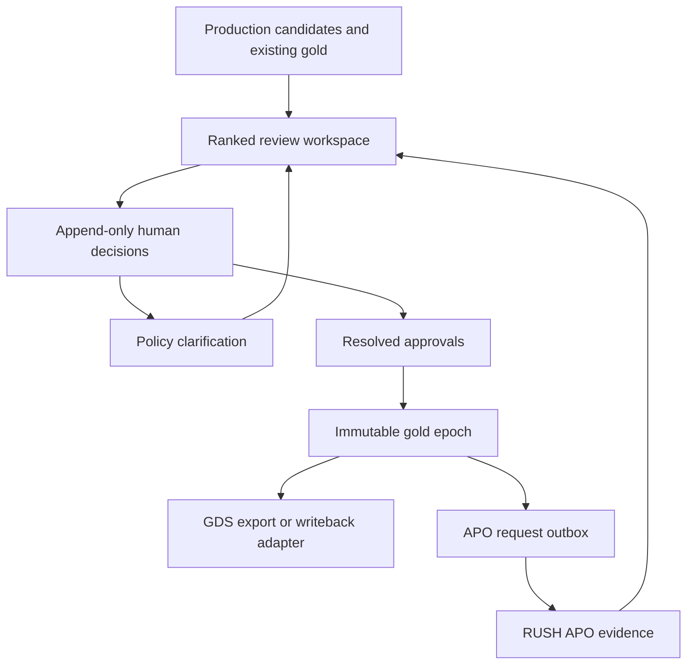

# RUSH labeling workspace

The labeling workspace is a working prototype of the human feedback layer around
RUSH. It combines a priority queue, original-content viewer and adjudication
panel with versioned golden-set maintenance. It uses the same standard-library
Python and plain JavaScript stack as the existing project.

## Run the Python service

Python 3.11 or later is sufficient. No additional packages, model keys or frontend
build are required for the labeling module.

```bash
python3 -m labeling.server --seed-demo --port 8090
```

Open <http://127.0.0.1:8090>. The server persists reviews and snapshots in
`data/labeling/labeling.sqlite3`, an ignored runtime directory. Restarting the
server preserves that database. Seeding is idempotent and must not reset
existing reviews. Use an alternate database path for isolated demonstrations or
tests. Run `python3 -m labeling.server --help` for the supported options.

The default viewer is the explicitly identified local demo Policy reviewer.
The server binds to localhost, matching the existing RUSH server's local
deployment model. This default is for a local prototype, not shared production
authentication.

### Reviewer authorization

For an authenticated local session, configure `RUSH_LABELING_TOKENS` as a JSON
object mapping bearer tokens to reviewer records with `id`, `name` and `role`.
Use private, unpredictable values supplied by your secret manager. Supported
roles are Ops, BPO, SME and Policy (`ops`, `bpo`, `sme`, `policy`). In token mode, the API
requires a valid token and derives the actor server-side. Submitted JSON cannot
grant a role or impersonate another reviewer.

The browser client sends a token from the tab's session storage key
`rush-labeling-token`. The UI provides a connection prompt when authentication
is needed. Tokens are not included in the repository, example fixtures or
exported snapshots. A production deployment should replace this prototype
authentication boundary with the organization's SSO and authorization service.

## Try the full workflow

1. Open **Review queue**. Filter by modality, category, project or status, or
   search the examples. Each row preserves the imported APO rank and reason.
2. Select an assistant turn. Input/user-abuse and output/AI-abuse decisions are
   independent targets. A correct refusal does not erase a problematic request.
3. For a new item, record an independent first pass. The API redacts AI and
   existing-gold guidance until that viewer has submitted the required labels.
   The first synthetic example includes an explicitly seeded first pass so the
   initial screen can demonstrate the richer adjudication view.
4. Inspect model confidence, policy citations and evidence. The illustrative
   confidence is not a calibrated probability. APO priority, gradient proxy,
   disagreement and route confidence remain distinct signals.
5. Approve resolved target labels with a rationale, or **Escalate to Policy**
   when policy meaning is unclear. `Uncertain` is never publishable gold. Route
   corrections retain the original route evidence and an audit event.
6. Open **Golden sets**, inspect staged approvals and publish a new local epoch.
   Publication atomically updates current gold and retains an immutable manifest
   and every preceding review. Protected holdout items cannot enter optimization
   exports through this workflow.
7. Download the epoch manifest or queue an APO handoff. A handoff pins the epoch
   and its content digest and remains **awaiting connector** until a production
   integration processes it. No model is called by this action.
8. Inspect **Policy insights** and **Activity** for outstanding clarifications
   and the history produced by these actions.

## Browser preview and Python mode

The same frontend supports two explicit modes:

| Mode | State | Intended use |
| --- | --- | --- |
| Browser demo | Synthetic fixtures and browser-local storage | Interactive design review with no backend or production connection |
| Python API | SQLite transactions, server-derived identity, role checks and durable events | Exercise the actual review, publication and handoff contracts |

`web/labeling/runtime.js` defaults to browser-demo mode. The Python server serves
its own runtime configuration with API mode enabled. It also blocks direct
downloads of `fixtures.json`, so the static seed file cannot bypass blind review
in API mode. Browser-demo state is deliberately inspectable and must never be
used as a secure labeling environment.

To serve just the browser demo independently:

```bash
python3 -m http.server 8091 --directory web/labeling --bind 127.0.0.1
```

Open <http://127.0.0.1:8091>. All images are local vector illustrations and all
example text, policy rules, priorities and confidence scores are synthetic.
The included dataset has 16 examples: three assistant conversations, eight pins
(including two relevance judgments) and five images, across seven categories.
It includes seven small local SVG illustrations and a protected holdout example.

## Architecture and ownership



The labeling platform owns the review experience and the label lifecycle.
Policy owns rule interpretation and boundary decisions. APO supplies ranking
and optimization. Prompt Manager retains final prompt review, promotion and
propagation. This prototype does not reimplement a router, optimizer or prompt
release system.

## Integration with the existing RUSH application

The implementation was scoped against repository commit
`51354e93ff3c15c3f27f5d10d51a3dc7bb9b2ba0`, the existing RUSH adjudication UI,
and [RUSH's About reference](https://rush.attiladobi.com/#about).

| Existing interface | What the labeling workspace can reuse | Remaining integration |
| --- | --- | --- |
| `GET /api/adjudication?area=…` | Ranked residuals, image IDs, votes, source runs, effective importance and gradient proxy | Normalize through the read-only adapter and reconcile project/category/target identities |
| `POST /api/adjudication/review` | Confirm/overturn/uncertain vocabulary | This existing endpoint writes a JSONL review log, not production golden-set snapshots |
| `pipeline/labelstore` | Append-only event and materialized-gold design | Map the target-aware prototype identity to the authoritative production label store |
| `POST /api/experiments/start` | Existing run, status and audit conventions | Preserve supported areas and current authorization/spend gates; dispatch only when the selected workflow accepts the exact snapshot contract |

The current experiment endpoint supports the existing image demos. Conversation
input/output labels need an explicit compatible consumer. A queued request is
not an optimization run, a local epoch is not a production writeback
acknowledgment, and this prototype reports no invented quality improvement.

The published handoff/export contract carries project, item, content version,
turn/target/category identity, policy version, effective label, dataset epoch
and manifest digest. Integrators should use that exact manifest and record the
downstream acknowledgment or error. The API contract is documented in
[labeling-contract.md](labeling-contract.md).

The read-only legacy queue adapter can be inspected with:

```bash
python3 -m labeling.adapters --area Generative_AI
```

It returns the existing ranked queue for a caller to map to the configured
project and target ontology. It does not submit a legacy review or launch a run.

### Existing policy graph and router

The graph contract is aligned with
[d-ai-trader at commit 02e35305](https://github.com/attdobi/d-ai-trader/tree/02e35305c506a381e1f1edf499fb907e0628d5f0).
The reusable parts are versioned node identity and text, typed relationships,
locked/pinned context, and evidence that distinguishes proposed, served and
cited policy. Human route overrides preserve that historical evidence.

The current trader has separate deterministic graph assembly, a typed local
selector with shadow/certification behavior, and optional hosted Decisions
routing for optional context. The labeling platform consumes their artifacts
and traces; it does not copy trading decisions, activate a router, or treat a
retained score-mass threshold as measured recall. The UI shows a selected
subgraph, including exception/boundary relationships, rather than replacing
the existing policy-area specialization with a single category prediction.

The policy-node examples and traces shipped here are synthetic Trust examples.
No live policy bundle, router response or trading state is bundled in the demo.

Inspect a materialized native graph without running trader code:

```bash
python3 -m labeling.policy_graph /path/to/d-ai-trader/agents/decider/policy-graph/latest/v61
```

The standard-library adapter reads the manifest, Markdown frontmatter and body,
typed edges, and referenced sibling code/LTM overlays. It verifies body hashes,
retains upstream prompt-field hashes and overlay versions as provenance, and
computes a separate canonical graph digest. It also accepts normalized graph
payloads through its Python functions. This is a read/validation boundary;
project onboarding must still map the imported taxonomy to the project's label
schema. The active graph catalog is seeded into a new database. Existing
initialized databases are not silently replaced when fixture files change.

## Reliability and production follow-up

The Python implementation validates target choices, actor roles and revision
preconditions. Idempotency keys protect retries. Independent labels, adjudication,
route changes, publication and APO requests are distinct persisted events.
Concurrent stale edits return a conflict instead of silently replacing newer work.

Before a shared production rollout, connect organizational identity, the
authoritative GDS store and the compatible APO runner. Add the organization's
retention controls, operational monitoring, deployment packaging and policy
version lifecycle. Policy and Ops must agree recurring category capacity and QA.
DS must agree coverage and evaluation criteria independently of the ranked
review sample. This implementation establishes the working contracts and local
workflow, not those organizational commitments.

## Verification

Run the focused tests from the repository root:

```bash
python3 -m unittest tests.test_labeling_store tests.test_labeling_http -v
node tests/test_labeling_demo.mjs
```

These tests exercise independent input/output persistence, server-side guidance
redaction, immutable epochs, protected holdout exclusion, optimistic conflicts,
retry idempotency, role and origin enforcement, and snapshot-pinned APO handoffs.
The frontend is additionally exercised through the complete browser-demo review,
publication and queued-handoff sequence.
